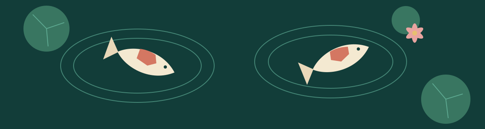
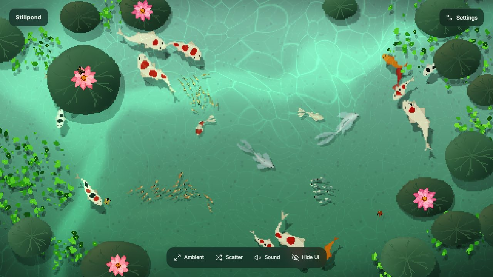

<!-- project:start -->
# Stillpond

A calm digital pond with procedural koi, full-viewport scenery, and English / Simplified Chinese controls.

**V1.4.0** · [Open the pond](https://seiya058904.github.io/stillpond/) · [Source](https://github.com/seiya058904/stillpond)
<!-- project:end -->

*Original pond illustration, not a screenshot.*

## Features

- **Watch a living pond:** procedural koi, platinum butterfly koi, Wakin goldfish, and schooling Medaka move through layered water and plants.
- **Interact gently:** click or tap to create a ripple and draw larger fish closer; scatter the school when you want a different response.
- **Change the scene:** adjust fish populations, composition, weather, light, and optional ambient sound.
- **Choose your controls:** use English or Simplified Chinese, everyday settings, and a separately loaded advanced editor.
- **Keep preferences locally:** settings are saved when browser storage is available; the pond can still use defaults when storage is denied.



*Actual Chromium capture of the local development version.*

## Controls

| Input | Action |
| --- | --- |
| Click or tap the water | Create a ripple and invite nearby fish |
| `Space` | Scatter fish |
| `[` / `]` | Change koi population |
| `F` | Toggle fullscreen where supported |
| `H` | Hide or restore the interface; tap the scene to restore it on touch devices |
| `R` / `D` | Restart the simulation / show procedural-spine diagnostics |

Resetting the pond restores fish, plants, water, and weather while keeping language, sound, and display preferences. Advanced undo and redo include fish counts and the remembered Medaka count.

## How it works

React, TypeScript, Vite, and Three.js compose the scene. The school controls movement independently from rendering; procedural spines create fish poses, while the renderer layers the pond bed, fish, water, plants, and weather. The display modes offer different frame-rate targets, not guaranteed performance on every device.

This is a procedural illustration rather than a scientific tank simulator. Behavior and proportions are tuned for the scene, and WebGL performance and visual detail can vary across devices and browsers.

## Run locally

**Prerequisites:** Node.js 22.12 or newer and npm.

```sh
npm ci
npm run dev
```

Open the local URL printed by Vite. To check project metadata, run the unit tests, type-check, and build:

```sh
npm run verify
npm run preview
```

Browser checks of WebGL recovery, visibility changes, pointer alignment, and touch interaction are separate from unit tests. Physical-device acceptance is also separate from simulated touch.

## Project map

- [`src/pond-runtime.ts`](src/pond-runtime.ts) — simulation lifetime, resizing, visibility, and WebGL recovery.
- [`src/school.ts`](src/school.ts), [`src/koi.ts`](src/koi.ts), [`src/goldfish.ts`](src/goldfish.ts), and [`src/butterfly-koi.ts`](src/butterfly-koi.ts) — movement and fish families.
- [`src/fish-renderer.ts`](src/fish-renderer.ts), [`src/settings/`](src/settings/), and [`src/i18n/`](src/i18n/) — rendering, preferences, and language.
- [How it works](docs/how-it-works.md) and [natural pond notes](docs/natural-pond.md) — movement, rendering, and visual-ecology boundaries.

[`project.config.json`](project.config.json) owns the machine-managed identity block above. Keep its storage namespace stable so existing preferences remain readable.

## Origin and license

Stillpond derives from [Nagomi by Mayank Kadam](https://github.com/msk1039/nagomi), based on upstream commit `01e93a410c0a317ee0a2b81e84a71e54a6db81d0`. The procedural fish, water, artwork, and core scene are inherited foundations extended here with interaction, presentation, accessibility, and ecology work.

The [PolyForm Noncommercial License 1.0.0](LICENSE) and [NOTICE](NOTICE) are preserved. This is not an MIT-licensed project and does not grant general commercial reuse permission.

Required Notice: Copyright 2026 Mayank Kadam (https://github.com/msk1039)
